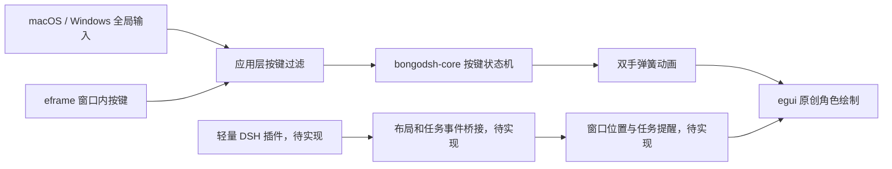

# BongoDSH 项目基调

建立日期：2026-11-02。

## 产品定位

BongoDSH 是一个常驻桌面的 Rust 打字挂件，首要平台为 macOS 和 Windows。独立桌面程序是主形态；2026-11-02 按用户新增要求实现直接运行在 DSH 内的页面插件版。页面插件可独立安装，桌面桥接仍为后续工作。

角色随输入节奏活动，停下来后恢复静止。最终常驻版本不抢输入焦点，不遮挡主要操作；当前默认窗口输入，用户可通过右键开启全局键盘。设置集中在右键菜单或托盘入口。第一版以小尺寸角色、清楚的左右手动作、克制的压下回弹为主。用户明确要求不配键盘图形。Rust 桌面原型使用矢量小鲸鱼；DSH 页面版已接入项目保存的六个彩色 PNG 角色。

原型采用雾蓝身体 `#A2D7DD`、蓝色阴影 `#75B6C4`、浅色腹部与双手 `#EBF8F6`、深蓝轮廓 `#2A4352` 和珊瑚腮红 `#EEABA0`。角色居中，只在悬停或焦点状态显示小型操作提示，不绘制背景面板。中文提示使用系统字体；缺失时回退为英文。

macOS 首批目标为 Apple Silicon 与 Intel，Windows 首批目标为 x86_64 MSVC。最低操作系统版本和安装包格式在桌面窗口验证后确定；Windows ARM64 和 Linux 暂不纳入首版验收。当前 CI 仅配置两个系统的默认 runner，不代表已验证所有架构。

## 参考结论

以下观察来自 2026-11-02 读取的上游 README、包配置和相关实现。

| 参考 | 已观察到的实现 | 本项目采用的方向 |
| --- | --- | --- |
| [dsh-bongo-fish](https://github.com/YUsaltyfish/dsh-bongo-fish) | DSH Web bundle；页面范围按键反馈；两种手部样式、配置、吸附和提醒 | 借鉴即时反馈与自定义能力，输入采集移到 Rust 平台适配层 |
| [dsh-whale-bongo](https://github.com/MeteorNOX/dsh-whale-bongo) | Web 插件加 Electron helper；独立桌面模式；双手回弹、透明穿透、窗口吸附 | 借鉴交互，Rust 进程承担桌面运行时 |

鲸鱼版的桌面管理入口见 [desktop.js](https://github.com/MeteorNOX/dsh-whale-bongo/blob/main/desktop.js)，DSH bundle 声明见 [package.json](https://github.com/MeteorNOX/dsh-whale-bongo/blob/main/package.json)。上游还包含 Windows PowerShell 辅助脚本，不能据此宣称已有 macOS 实现。

两者的代码和素材采用不同授权说明。当前未复制上游原始图片、音效或代码；页面版角色是基于用户指定参考图和附件生成的素材，来源和许可单独记录于 [DSH 角色接入记录](dsh-character-assets.md)。本项目代码许可证待项目所有者决定。

## 技术方向

| 领域 | 基线选择 | 落地状态 |
| --- | --- | --- |
| 语言与工程 | Rust stable、Edition 2024、Cargo workspace；当前最低 Rust 1.93 | 已配置 |
| 核心规则 | 纯 Rust、标准库、确定性的输入状态机和弹簧动画 | 已实现 |
| 桌面 UI | egui/eframe 0.34.3，Glow 渲染，按需重绘 | 原型已实现 |
| 原生能力 | 窗口由 eframe/winit 提供；全局键盘由独立平台模块提供 | 已接入；完整实机验收见全局输入文档 |
| 设置与资产 | 本地文件、版本化配置、独立素材目录 | 尚未实现 |
| DSH 页面版 | 独立 Web bundle，六个彩色角色与本地设置 | 已实现；macOS DSH 安装、启用和六个角色切换通过 |
| DSH 桌面桥接 | 轻量 Web/Host 插件与本地桌面进程通信 | 后续阶段 |

选择原生 Rust UI 是为了让桌面程序独立启动，并将状态规则放在同一套 Rust 代码中。当前锁定 eframe 0.34.3，其包声明的最低 Rust 版本为 1.92，兼容项目 Rust 1.93。egui 的 [ViewportBuilder](https://docs.rs/egui/0.34.3/egui/viewport/struct.ViewportBuilder.html) 提供透明、无边框和置顶配置；实际平台效果须分别验证。点击穿透、托盘退出与跨屏缩放尚未纳入本轮原型。

桌面使用 eframe，只启用 `glow` 和 `default_fonts`。托盘、配置序列化和音频库后续按需引入，不预装完整 async 运行时或大型引擎。升级 GUI 库时需要重新核对 MSRV 和对应版本 API。

## 代码边界

- `bongodsh-core` 只消费 `InputEvent`，输出 `Feedback`。`strike` 驱动一次敲击反馈，`pose` 描述按住状态；二者不能混用，否则长按会反复播放音效。
- 新的有效按下交替分配左右手；同一次按住期间归属不变。松开后再次按下视作新的敲击，目前不实现跨次按压的固定键位映射。
- 同一输入源内的 `KeyId` 表示物理键，不表示输入文字。IME 组合文本不进入核心，不按文字长度补发动画。
- 核心对重复按下、系统连发、未知松开保持幂等；同一只手关联多个按住键时，全部松开才抬起。
- `HandAnimation` 为短促敲击保留最短可见时间，避免同一帧内按下并松开时没有动画。静止或长按稳定后停止请求连续重绘；弹簧使用固定上限子步，避免拖动或长暂停后的数值失稳。
- 主应用负责快捷键过滤、输入源选择和动画时钟。平台切换、监听失效、暂停和休眠会发送 `Reset`；重置后迟到的系统连发不能再次按住角色的手。
- 本地演示的数字键标识为模拟数据。生产日志只记录权限或设备状态，不输出按键流和输入内容。

## 两个平台的验证边界

| 能力 | macOS | Windows |
| --- | --- | --- |
| 全局输入 | 已接入只读 CGEventTap 与 Input Monitoring 申请；已验证未授权降级，已授权场景待实测 | 已接入独立线程低级键盘钩子，避免覆盖 winit 的 Raw Input 注册；实机待验收 |
| 透明窗口 | 验证透明合成、窗口层级、Spaces 和全屏应用行为 | 验证透明背景、置顶、任务栏隐藏和焦点行为 |
| 点击穿透 | 先提供整窗穿透与托盘恢复操作；角色区域命中另行验证 | 同样先验证穿透后仍能恢复交互，再做按区域命中 |
| 多屏 | 验证不同缩放、负坐标、拔屏后召回及 Intel / Apple Silicon | 验证 100% / 125% / 150% / 200% 与混合 DPI |
| 生命周期 | 监听启停、权限撤销、睡眠唤醒、退出清理 | 监听启停、会话锁定、睡眠唤醒、退出清理 |

Windows 输入设计参考 [Microsoft LowLevelKeyboardProc](https://learn.microsoft.com/en-us/windows/win32/winmsg/lowlevelkeyboardproc)。输入回调只投递事件；渲染、音频和文件读取在回调外执行。

全局输入使用现有锁文件中的 `objc2-core-graphics 0.3.2`、`objc2-core-foundation 0.3.2` 和 `windows-sys 0.61.2` 作为按平台编译的直接依赖，只启用事件监听、运行循环及必要 Win32 API 功能。macOS 的睡眠通知与安全输入查询使用隔离 FFI。生命周期、权限操作与当前验证范围见 [全局键盘监听](global-keyboard.md)。

## DSH 页面插件

`plugins/dsh-bongodsh/` 是可单独安装的 DSH Web bundle。宿主入口仅用于发现客户端；浏览器脚本管理物理按键状态、PNG 图层动画、角色切换、拖动、页面输入框吸附和本地设置。它不依赖 Rust 运行时，不启动网络服务，也不调用系统键盘接口。动作规则与桌面核心保持一致，但由独立 JavaScript 实现。角色原图保存在根目录 `assets/`，构建时将所需彩稿原样内嵌到客户端并去重；没有独立手部素材的角色仅做身体动作。

布局只读取 DSH 的 `[data-composer-card]` 区域，使用 CSS 像素。标记不存在或不可见时回退至页面边缘；不将页面坐标当成屏幕坐标。没有接入任务完成事件。客户端格式和输入框标记已对照本机 DSH `0.2.1-rc.5` 的包内容核验，实际安装与平台边界见 [插件说明](../plugins/dsh-bongodsh/README.md)。

## DSH 桌面桥接约定草案

DSH 内的输入框属于页面布局，桌面窗口 API 不能提供它的精确位置。后续插件负责发送输入框或任务面板的可见区域、宿主窗口信息及任务完成事件。坐标协议必须区分页面 CSS 像素、窗口坐标和屏幕物理像素，携带缩放及显示器信息。

桌面桥接需先验证 DSH 宿主的屏幕坐标 API，再确定传输协议。若使用回环网络通信，限定本机、每次会话配对、校验来源与消息长度，携带版本和序号；不提供任意文件读取或命令执行接口。当前可安装的页面插件不启动桥接网络监听，也不支持桌面进程配对。

桌面模式以原生输入为唯一按键源。只有明确切换到 DSH 输入时才消费桥接按键，避免双源重复触发；切换前清空按住状态。DSH 退出或桥接断连后，独立挂件继续运行并解除页面吸附。

## 分期与验收

1. **工程基线。** Cargo 工程、输入状态机、开发约定、模拟演示、双平台 CI 配置。已建立。
2. **桌面原型。** 原创小鲸鱼与双手、透明置顶窗口、拖动、右键菜单、暂停和退出已实现。已在 macOS 启动检查；Windows 通过目标编译检查，仍待实机验证。
3. **独立挂件。** 接入全局键盘、权限提示、暂停、托盘、穿透、音量与配置持久化；异常恢复后没有卡住的手或残留监听线程。
4. **DSH 联动。** 输入框定位、窗口跟随、任务提醒、断连恢复，验收输入事件无重复和不同 DPI 下的坐标一致性。
5. **可分发版本。** 自定义素材、性能测量、签名和安装包；发布授权单独处理。

第一版性能目标是静止时按需等待、动作时才连续重绘，键盘输入到首次视觉反馈争取控制在 50ms 内。这里只定义验收目标，不代表已有性能实测结果。

## 基线验证

本地使用 macOS Apple Silicon、Rust 1.93.1 验证，已启动桌面原型检查角色、中文菜单、双手演示与拖动。Windows x86_64 MSVC 已通过 `cargo check --workspace --all-targets --target x86_64-pc-windows-msvc --locked`。该检查不生成可运行 Windows 安装包，也不能替代 Windows 实机运行。Intel macOS 运行和远端 CI 尚未验证。

本地回归覆盖新按下交替、长按连发、重复事件、多键重叠、同手释放、未知松开、重置后的迟到事件、短按可见性、动画收敛、快捷键过滤及 egui 输入帧和焦点变化。测试文件按用户约定留在本地忽略目录，不能提交或推送，远端 CI 不包含这些用例。
